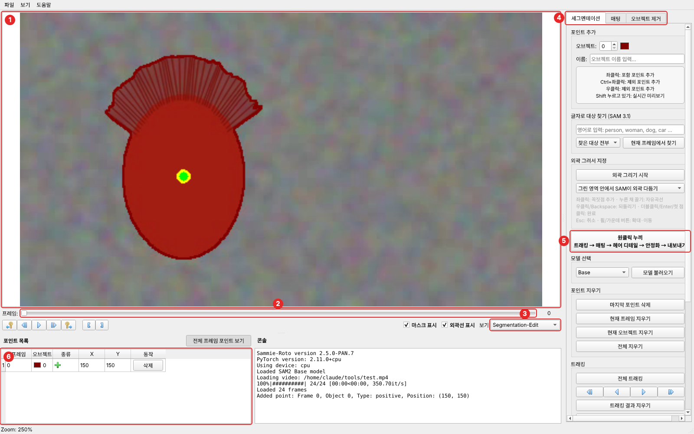
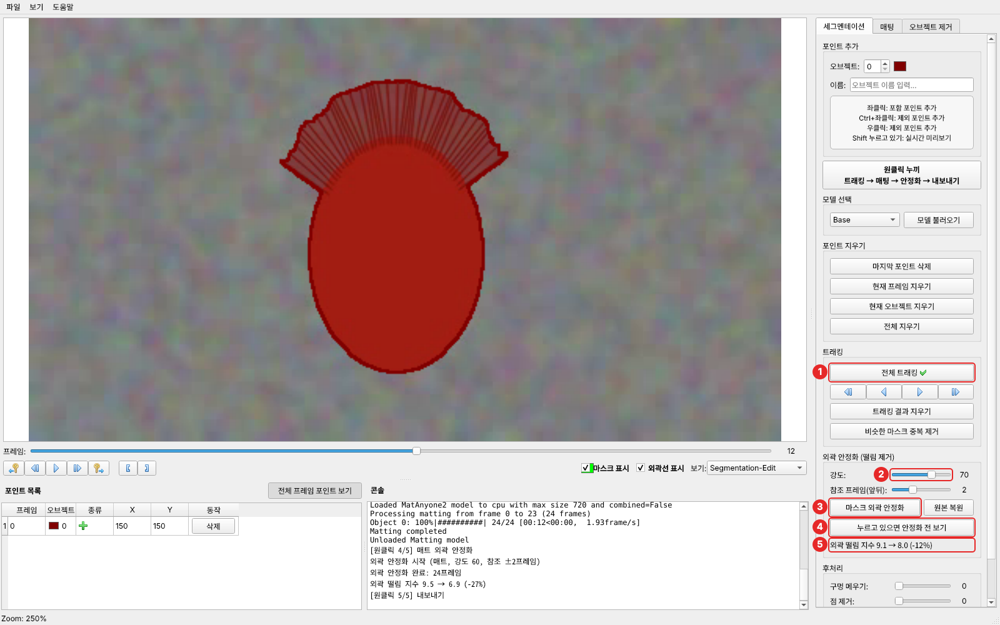
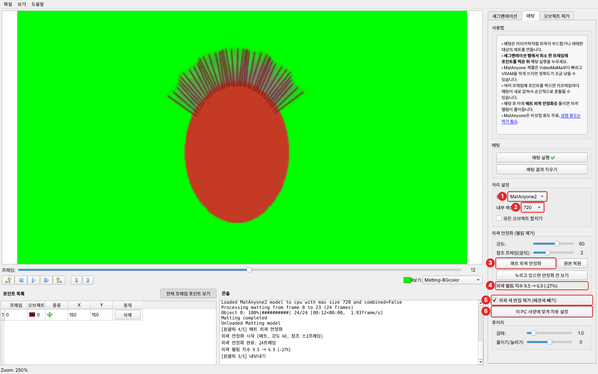
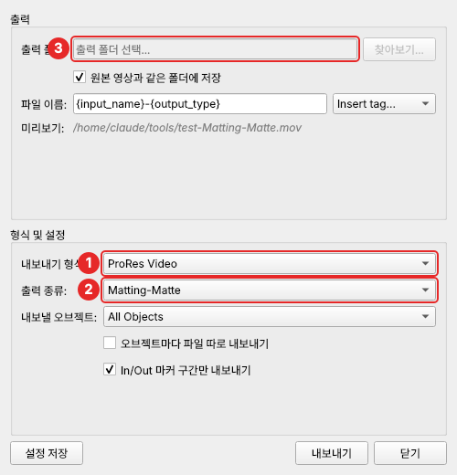

# Sammie-Roto PAN

영상에서 사람이나 사물을 AI로 따내는(로토스코핑·누끼) 윈도우용 데스크톱 툴입니다.
대상 위에 점 몇 개만 찍으면 전체 프레임의 마스크를 만들고, 머리카락 같은 반투명 외곽까지 매트로 뽑아 줍니다.

오픈소스 [Sammie-Roto 2](https://github.com/Zarxrax/Sammie-Roto-2) v2.5.0(GPL-3.0)을 바탕으로, 실무에서 걸리던 **외곽 떨림**과 **머리카락 외곽 품질**을 손보고 한국어로 쓸 수 있게 만든 전용 빌드입니다.

## 원본과 달라진 점

| 기능 | 설명 |
|---|---|
| 글자로 대상 찾기 (SAM 3.1) | "person"처럼 영어로 입력하면 SAM 3.1이 현재 프레임에서 대상을 찾아 오브젝트로 만들고, 트래킹은 SAM 2가 이어서 함 |
| 외곽 그려서 지정 | 대상 둘레를 대충 다각형으로 그리면, 그 영역 안에서 SAM이 실제 경계를 찾아 붙이고 SAM 2가 영상 전체를 따라감. 난간·차·세트처럼 점으로 잘 안 잡히는 대상용 |
| 원클릭 누끼 | 점만 찍고 버튼 하나로 트래킹 → 마스크 안정화 → 매팅 → 헤어 디테일 보정 → 매트 안정화 → 내보내기 창까지 진행 |
| 헤어 디테일 보정 | 매팅 결과를 길잡이로, 외곽의 불확실한 띠만 원본 해상도에서 다시 계산(ViTMatte). 뭉개진 머리카락·잔털 외곽을 실제 경계에 맞춤 |
| 외곽 안정화 | 프레임마다 외곽이 떨리는 현상을 줄임. 마스크용·매트용 각각 제공 |
| 전후 비교·떨림 지수 | 안정화 전후를 버튼으로 바로 비교하고, 떨림이 얼마나 줄었는지 숫자로 표시 |
| 외곽 색 번짐 제거 | 반투명 외곽에 섞인 원래 배경색을 빼서, 다른 배경에 합성해도 테두리가 남지 않게 함 |
| PC 사양 자동 맞춤 | 그래픽카드 메모리를 확인해 매팅 모델·해상도를 정하고, 메모리가 모자라면 설정을 낮춰 다시 시도 |
| 한국어 화면 | 메뉴·버튼·툴팁·안내문을 한국어로 표시 |
| 원클릭 설치 | `install.bat` 하나로 GPU 감지부터 모델 다운로드까지 질문 없이 진행 |

---

## 1. 설치

### 필요 사양

- Windows 10/11 (64비트)
- NVIDIA 그래픽카드 권장: VRAM 8GB 이상. 최고 품질 매팅 모델(VideoMaMa)은 12GB 이상
- 디스크 여유 공간 30GB 이상
- 인터넷은 **설치할 때만** 필요합니다 (패키지와 모델 약 13GB 다운로드). 설치가 끝나면 인터넷 없이 동작합니다.

그래픽카드가 없어도 CPU로 돌아가지만 매우 느리고 VideoMaMa는 쓸 수 없습니다.

### 설치 순서

1. 이 저장소 오른쪽 위 `Code → Download ZIP`으로 받거나, 전달받은 `Sammie-Roto-PAN-x.x.x.zip`을 준비합니다.
2. `C:\Tools\Sammie-Roto-PAN`처럼 **일반 폴더**에 압축을 풉니다.
   - `Program Files`, 바탕화면(OneDrive 동기화 폴더), 한글·공백이 많은 깊은 경로는 피하세요.
   - 압축 파일 안에서 바로 실행하면 안 됩니다. 반드시 먼저 풀어야 합니다.
3. `install.bat`을 더블클릭합니다. 검은 창이 뜨고 아래 순서로 자동 진행됩니다.
   - 그래픽카드 감지 → 파이썬·패키지 설치 → 바탕화면 바로가기 생성 → 모델 전체 다운로드
   - 처음에는 20~40분 걸립니다. 창을 닫지 말고 "설치 완료!"가 나올 때까지 기다리세요.
4. 바탕화면의 **Sammie-Roto PAN** 아이콘으로 실행합니다. 아이콘이 없으면 폴더 안의 `run_sammie.bat`을 실행하세요.

### 업데이트(패치) 적용

새 기능이나 수정은 다시 설치하지 않고 **패치 파일**(`Sammie-Roto-PAN-patch-버전.zip`)로 받습니다. 받아 둔 모델과 설정, 작업 중인 프로젝트는 그대로 유지됩니다.

**최신 패치 받기**: [Sammie-Roto-PAN-patch-2.5.0-PAN.7.zip](https://github.com/Josingp/sammie-roto-pan/raw/main/patches/Sammie-Roto-PAN-patch-2.5.0-PAN.7.zip) (이 저장소의 [`patches`](patches) 폴더에 있습니다)

1. Sammie-Roto PAN을 **종료**합니다.
2. 패치 zip을 아무 곳에나 압축 풉니다. (바탕화면도 괜찮습니다)
3. 풀린 폴더 안의 `apply_patch.bat`을 더블클릭합니다.
   - 바탕화면 바로가기를 보고 설치 폴더를 자동으로 찾습니다.
   - 못 찾으면 "Drag the Sammie-Roto PAN install folder..."가 나옵니다. 설치 폴더를 그 창에 끌어다 놓고 엔터를 누르세요.
4. "패치 완료!"와 새 버전 번호가 나오면 끝입니다. 프로그램을 다시 실행하세요.

- 패치는 **누적형**입니다. 중간 버전을 건너뛰어도 최신 패치 하나만 적용하면 됩니다.
- 바뀌기 전 파일은 설치 폴더의 `patch_backup\날짜시간\`에 보관됩니다.
- 패치에 새 모델이 필요하면 그때 받습니다. 인터넷이 없으면 안내만 하고 넘어가니, 나중에 `install.bat → 2) 모델 다시 받기`를 실행하세요.
- 현재 버전은 `도움말 → 정보` 또는 창 제목에서 확인합니다.
- 설치가 아직 진행 중이면 **설치가 끝난 뒤에** 패치를 적용하세요.

### 인터넷 없는 PC에서 쓰기

설치가 끝난 뒤에는 인터넷을 끊어도 모든 기능이 동작합니다. 필요한 모델은 모두 프로그램 폴더 안(`checkpoints`)에 저장되고, 업데이트 확인이나 사용 기록 전송도 하지 않습니다.

- 설치 중 모델 다운로드가 끊긴 채로 인터넷을 끊으면, 빠진 모델을 쓰는 기능만 안 됩니다. 인터넷이 될 때 `install.bat → 2) 모델 다시 받기`를 실행하세요.
- 인터넷이 아예 안 되는 PC라면, 인터넷 되는 PC에서 같은 위치(예: `C:\Tools\Sammie-Roto-PAN`)에 설치를 끝낸 뒤 폴더째 복사해 옵니다. 그래픽카드 종류가 같아야 하고, 복사한 뒤 `run_sammie.bat`으로 실행합니다.

### 재설치·모델 다시 받기·삭제

- 이미 설치된 상태에서 `install.bat`을 다시 실행하면 메뉴가 나옵니다.
  - `1) 재설치/복구`: 프로그램이 안 켜질 때
  - `2) 모델 다시 받기`: 다운로드가 중간에 끊겼을 때. 이미 받은 파일은 건너뜁니다.
- 삭제는 폴더를 통째로 지우고 바탕화면 아이콘을 지우면 끝입니다. 다른 곳에 남는 파일은 없습니다.
- 폴더를 다른 위치로 옮겼다면 `install.bat`을 한 번 다시 실행하세요.

---

## 2. 화면 구성

| 번호 | 이름 | 설명 |
|---|---|---|
| ① | 영상 화면 | 여기에 점을 찍습니다. 빨갛게 칠해진 부분이 따질 영역, 초록 점이 찍은 포인트입니다. |
| ② | 프레임 슬라이더 | 프레임을 이동합니다. 아래 버튼으로 재생, 키프레임 이동, In/Out 마커 설정을 합니다. |
| ③ | 보기 | 화면에 무엇을 보여줄지 고릅니다. (아래 표) |
| ④ | 작업 탭 | 세그멘테이션 / 매팅 / 오브젝트 제거 |
| ⑤ | 원클릭 누끼 | 점을 찍은 뒤 이 버튼 하나로 끝까지 진행합니다. |
| ⑥ | 포인트 목록 | 찍은 점의 목록입니다. `삭제`로 하나씩 지울 수 있습니다. 오른쪽 콘솔에는 진행 상황이 나옵니다. |

화면 캡처는 테스트용 합성 영상으로 찍은 것입니다. 윈도우에서는 글꼴과 창 테두리가 조금 다르게 보입니다.

- **가운데**: 영상 화면. 여기에 점을 찍습니다. 마우스 휠로 확대·축소합니다.
- **화면 아래**: 프레임 슬라이더, 재생 버튼, In/Out 마커 버튼, `보기` 선택.
- **오른쪽**: 작업 탭 세 개.
  - `세그멘테이션`: 점 찍기, 트래킹, 마스크 외곽 안정화
  - `매팅`: 머리카락 등 반투명 외곽 매트 만들기, 매트 외곽 안정화, 색 번짐 제거
  - `오브젝트 제거`: 따낸 대상을 영상에서 지우기
- **맨 아래**: 찍은 포인트 목록과 콘솔(진행 상황·오류 메시지).

`보기` 항목은 프로그램 내부 값이라 영어 그대로입니다.

| 보기 | 내용 | 단축키 |
|---|---|---|
| Segmentation-Edit | 원본 위에 마스크를 색으로 겹쳐 보기 (점 찍을 때) | F2 |
| Segmentation-Matte | 마스크를 흑백으로 보기 | F3 |
| Segmentation-BGcolor | 마스크로 따낸 결과를 단색 배경 위에 보기 | F4 |
| Matting-Matte | 매팅 결과를 흑백으로 보기 | F5 |
| Matting-BGcolor | 매팅으로 따낸 결과를 단색 배경 위에 보기 | F6 |
| ObjectRemoval | 오브젝트 제거 결과 보기 | F7 |

---

## 3. 가장 빠른 사용법: 원클릭 누끼

1. **영상 열기**: `파일 → 영상 불러오기`(Ctrl+O) 또는 영상 파일을 화면에 끌어다 놓습니다.
   - 지원 형식: mp4, mov, mkv, m4v, avi, webm, 이미지 시퀀스(png, jpg, tiff 등)
2. **점 찍기**: 따낼 대상 위를 **좌클릭**합니다. 색이 입혀진 영역이 따질 영역입니다.
   - 빠진 부분은 좌클릭으로 더 찍습니다.
   - 잘못 들어간 부분은 **우클릭**(또는 Ctrl+좌클릭)으로 제외합니다.
   - **Shift**를 누른 채 마우스를 움직이면 찍기 전에 결과를 미리 볼 수 있습니다.
3. **원클릭 누끼** 버튼을 누릅니다. 여섯 단계가 자동으로 이어집니다.
   1. 전체 트래킹: 마스크를 모든 프레임에 퍼뜨림
   2. 마스크 외곽 안정화
   3. 매팅: PC 사양에 맞는 모델과 해상도를 자동으로 선택 (아래 "PC 사양 자동 맞춤" 참고)
   4. 헤어 디테일 보정: 머리카락·잔털 외곽을 원본 해상도에서 다시 계산 (매팅 탭에서 끌 수 있음, 5장 참고)
   5. 매트 외곽 안정화
   6. 내보내기 창 열기
4. **내보내기** 창에서 형식과 출력 종류를 고르고 `내보내기`를 누릅니다. (6장 참고)

중간에 진행 창의 `취소`를 누르면 그 단계에서 멈춥니다. 이미 끝난 단계의 결과는 남아 있습니다.

---

## 4. 단계별로 직접 하기

결과가 마음에 안 들거나 세밀하게 조절하고 싶을 때 씁니다.

### 4-1. 점 잘 찍는 요령

- 점은 적을수록 좋습니다. 보통 포함 1~3개, 제외 0~2개면 충분합니다.
- 대상이 가장 잘 보이는 프레임에서 찍으세요. 꼭 첫 프레임일 필요는 없습니다.
- 트래킹 후 마스크가 틀어지는 프레임이 있으면, 그 프레임으로 가서 점을 추가하고 다시 트래킹합니다. 점을 찍은 프레임은 **키프레임**이 되고, PgUp/PgDown으로 오갈 수 있습니다.
- 여러 대상을 따로 따려면 `오브젝트` 번호를 바꿔서 찍습니다. 번호마다 색이 다르고 내보낼 때 따로 저장할 수 있습니다.
- 영상 일부만 작업하려면 `[`(In)과 `]`(Out) 마커로 구간을 정합니다. 트래킹·매팅·내보내기가 그 구간에만 적용됩니다.

### 4-1-1. 글자로 대상 찾기 (SAM 3.1)

점을 찍는 대신 글자로 대상을 지정합니다. 사람이 여러 명이거나 대상 모양이 복잡할 때 편합니다.

1. 대상이 잘 보이는 프레임으로 이동합니다.
2. 세그멘테이션 탭의 **글자로 대상 찾기** 칸에 **영어로** 입력합니다.
   - 예: `person`, `woman with long hair`, `man in black suit`, `dog`, `car`
   - 한글은 알아듣지 못합니다.
3. `찾은 대상 전부` 또는 `가장 큰 1개만`을 고르고 **현재 프레임에서 찾기**를 누릅니다.
   - 처음엔 모델을 불러오느라 30초~1분 걸립니다.
   - 찾은 대상마다 오브젝트 번호가 새로 붙고, 이름이 `person 0`처럼 자동으로 들어갑니다.
4. **전체 트래킹** 또는 **원클릭 누끼**를 누르면 SAM 2가 그 마스크를 시작점으로 영상 전체를 따라갑니다.

- 찾은 프레임에 점을 더 찍으면 그 프레임은 점 기준으로 다시 잡힙니다. 다른 프레임에서 점으로 보정하는 것은 평소와 같습니다.
- 대상을 지우려면 그 오브젝트를 선택하고 `현재 오브젝트 지우기`를 누릅니다.
- SAM 3.1은 찾을 때만 그래픽카드에 올렸다가 바로 내리므로, 트래킹·매팅 메모리에는 영향이 없습니다.
- NVIDIA 그래픽카드가 필요합니다.

**SAM 3.1 모델 파일 준비 (처음 한 번)**

SAM 3.1 모델은 Meta의 승인을 받아야 받을 수 있어서 자동으로 설치되지 않습니다.

1. https://huggingface.co/facebook/sam3.1 에서 로그인 후 접근 신청 → 승인 메일 대기
2. 승인되면 `Files and versions` 탭에서 `sam3.1_multiplex.pt`(약 3.5GB)를 다운로드
3. 받은 파일을 Sammie-Roto PAN 폴더 안의 `checkpoints` 폴더에 넣기 (프로그램 폴더 바로 아래에 두면 처음 찾을 때 자동으로 옮겨집니다)

SAM 3.1 라이선스(SAM License)는 상업 이용이 가능합니다. 군사·무기 등 일부 용도만 금지됩니다.

### 4-1-2. 외곽 그려서 지정

점이나 글자로 잘 안 잡히는 대상(난간, 다리, 차, 세트 등)은 둘레를 직접 그려서 지정합니다.

1. 오브젝트 번호를 고르고, 대상이 잘 보이는 프레임으로 이동합니다.
2. 세그멘테이션 탭의 **외곽 그리기 시작**을 누릅니다.
3. 대상 둘레를 따라 좌클릭으로 꼭짓점을 찍습니다. 누른 채 끌면 자유곡선으로 그려집니다.
   - 우클릭 또는 Backspace: 마지막 점 되돌리기
   - 더블클릭, Enter, 첫 점 다시 클릭: 완료
   - Esc: 취소 / 휠·가운데 버튼: 확대·이동
4. 완료하면 바로 마스크가 생깁니다.
   - **그린 영역 안에서 SAM이 외곽 다듬기**(기본): 대충 그려도 SAM이 실제 경계에 맞춰 붙입니다. 그린 선 밖은 잘라냅니다.
   - **그린 모양 그대로**: 그린 다각형을 그대로 씁니다. 경계가 애매해서 SAM이 엉뚱하게 잡을 때 쓰세요.
5. 카메라가 크게 움직이면 처음·중간·끝 프레임에 한 번씩 그린 뒤 **전체 트래킹**을 누릅니다.

그 프레임에 같은 오브젝트로 찍어 둔 점이 있으면 그린 외곽으로 바뀝니다. 그다음 같은 프레임에 점을 더 찍으면 점 기준으로 다시 잡힙니다.

### 4-2. 세그멘테이션 탭

트래킹과 마스크 외곽 안정화를 마친 화면입니다.

- ① **전체 트래킹**: 끝나면 버튼에 초록 체크가 붙습니다.
- ② **강도**: 외곽 안정화를 얼마나 세게 걸지 정합니다.
- ③ **마스크 외곽 안정화**: 실행 버튼. 옆의 `원본 복원`으로 되돌립니다.
- ④ **누르고 있으면 안정화 전 보기**: 누르고 있는 동안만 안정화 전 상태를 보여 줍니다.
- ⑤ **외곽 떨림 지수**: 안정화 전 → 후 수치와 줄어든 비율입니다.

| 항목 | 설명 |
|---|---|
| 모델 선택 | Base(기본), Large(느리지만 조금 더 정확), Efficient(빠름), Anime(애니메이션용) |
| 전체 트래킹 (Ctrl+T) | 찍은 점을 기준으로 전체 프레임에 마스크 생성 |
| ◀ ▶ 버튼 | 현재 프레임에서 앞·뒤 방향으로만, 또는 한 프레임씩 트래킹 |
| 트래킹 결과 지우기 | 마스크만 지우고 점은 남김 |
| 비슷한 마스크 중복 제거 | 같은 그림이 반복되는 애니메이션 전용 |
| 외곽 안정화 | 5장 참고 |
| 후처리 슬라이더 | 구멍 메우기, 점 제거, 화면 가장자리 보정, 줄이기/늘리기. 원본을 바꾸지 않고 보기와 내보내기에만 적용 |

세그멘테이션 마스크는 외곽이 딱 잘린 흑백입니다. 옷이나 소품처럼 외곽이 단단한 대상은 여기까지만 해도 됩니다. 머리카락·털·연기처럼 반투명한 외곽은 매팅까지 해야 합니다.

### 4-3. 매팅 탭

매팅, 헤어 디테일 보정, 매트 외곽 안정화를 마치고 `Matting-BGcolor` 보기로 확인하는 화면입니다. 머리카락 가닥 사이로 배경색이 비쳐 보입니다.

- ① **모델**, ② **내부 해상도**: 직접 고르거나 ⑦로 자동 설정합니다.
- ③ **헤어 디테일 보정**: 매팅이 끝난 뒤 실행합니다. 뭉개진 머리카락 외곽을 원본 해상도에서 다시 계산합니다. (5장 참고)
- ④ **매트 외곽 안정화**: 헤어 디테일 보정 다음에 실행합니다.
- ⑤ **외곽 떨림 지수**: 안정화 전 → 후.
- ⑥ **외곽 색 번짐 제거**: 반투명 외곽에서 원래 배경색을 뺍니다.
- ⑦ **이 PC 사양에 맞게 자동 설정**: 그래픽카드에 맞춰 ①②를 정해 줍니다.

| 항목 | 설명 |
|---|---|
| 모델 | **VideoMaMa**: 품질 최고, 느림, VRAM 많이 씀. **MatAnyone2**: 빠르고 가벼움. MatAnyone: 이전 버전 |
| 내부 해상도 | 이 크기로 줄여서 처리. 머리카락 디테일이 중요하면 1080 이상. 메모리 부족 오류가 나면 낮춤 |
| 배치 겹침 프레임 / 배치당 프레임 | VideoMaMa 전용. 메모리 부족 오류가 나면 배치당 프레임을 낮춤 |
| 모든 오브젝트 합치기 | 여러 오브젝트를 하나로 합쳐서 매팅 |
| 매팅 실행 (Ctrl+M) | 매팅 시작 |
| 헤어 디테일 보정 | 매팅이 끝난 뒤 실행. 탐색 폭·정밀도 조절, 전후 비교, 원본 복원. 5장 참고 |
| 외곽 안정화 | 5장 참고 |
| 외곽 색 번짐 제거 | 5장 참고 |
| 감마 | 1.0보다 낮추면 반투명 외곽이 얇아지고, 높이면 두꺼워짐 |
| 줄이기/늘리기 | 매트 영역을 줄이거나 늘림 |

- VideoMaMa는 **전체 트래킹이 끝난 상태**여야 합니다. MatAnyone 계열은 점만 찍혀 있어도 됩니다.
- 결과는 `Matting-Matte`(F5) 보기에서 흑백으로, `Matting-BGcolor`(F6)에서 단색 배경 위로 확인합니다. 배경색은 `보기` 옆 색 상자를 눌러 바꿉니다.

### 4-4. 오브젝트 제거 탭

따낸 대상을 영상에서 지우고 빈자리를 채웁니다. 먼저 전체 트래킹이 되어 있어야 합니다.

- **MiniMax-Remover**: 품질이 좋지만 몇 초 분량만 가능
- **ProPainterX**: 긴 클립 가능, 품질은 낮음. 움직이는 대상에 적합

---

## 5. 외곽 품질 기능

### 외곽 안정화 (떨림 제거)

AI는 프레임마다 외곽을 따로 판단하기 때문에, 재생하면 외곽이 미세하게 떨려 보입니다. 이 기능은 앞뒤 프레임의 외곽을 움직임에 맞춰 정렬한 뒤 서로 맞춰서 떨림을 줄입니다. 외곽 부분만 처리하고 안쪽은 건드리지 않습니다.

- **세그멘테이션 탭의 `마스크 외곽 안정화`**: 트래킹 후 사용
- **매팅 탭의 `매트 외곽 안정화`**: 매팅 후 사용

| 조절 | 기본값 | 설명 |
|---|---|---|
| 강도 | 마스크 70 / 매트 60 | 높을수록 떨림이 줄어듦. 빠른 동작에서 외곽이 늦게 따라오면 낮춤 |
| 참조 프레임(앞뒤) | 2 | 앞뒤 몇 프레임을 참고할지. 떨림이 심하면 3~4 |

- 실행이 끝나면 버튼 아래에 **외곽 떨림 지수 전 → 후 (%)** 가 나옵니다. 숫자가 낮을수록 안정적입니다. 강도를 바꿔 가며 이 숫자를 기준으로 맞추면 됩니다.
- **`누르고 있으면 안정화 전 보기`**: 누르고 있는 동안 안정화 전 상태를 보여 줍니다. 같은 프레임에서 전후를 바로 비교할 수 있습니다.
- **`원본 복원`**: 안정화 전으로 되돌립니다.
- 강도를 바꿔 여러 번 돌려도 매번 원본에서 다시 계산하므로 결과가 겹쳐서 뭉개지지 않습니다.
- 트래킹이나 매팅을 다시 하면 안정화도 다시 해야 합니다.

### 헤어 디테일 보정 (머리카락·잔털)

매팅 모델은 "어디가 대상인지"는 잘 맞히지만 외곽이 뭉개질 때가 있습니다.

- **VideoMaMa**는 내부에서 영상을 압축해서 계산하기 때문에 외곽이 몇 픽셀씩 부드럽게 번집니다.
- **내부 해상도보다 큰 영상**(예: 4K 영상을 720으로 계산)은 줄여서 계산한 뒤 다시 늘리므로 가는 머리카락이 사라집니다.

헤어 디테일 보정은 매팅 결과를 길잡이로 삼아, **외곽의 불확실한 띠만 원본 해상도 그대로** 이미지 매팅 모델(ViTMatte)로 다시 계산합니다. 확실한 안쪽과 바깥쪽은 건드리지 않으므로 대상이 바뀌거나 엉뚱한 곳이 따지는 일은 없습니다.

- 매팅 탭의 **`헤어 디테일 보정`** 버튼: 매팅 후 사용. 원클릭 누끼에는 기본으로 들어 있습니다(`원클릭 누끼에 포함` 체크).
- 순서는 **매팅 → 헤어 디테일 보정 → 매트 외곽 안정화**입니다. 안정화가 켜진 상태에서 보정을 돌리면 보정된 매트로 안정화를 알아서 다시 적용합니다.
- **`누르고 있으면 보정 전 보기`**: 같은 프레임에서 전후를 바로 비교합니다. `Matting-Matte`(F5) 보기에서 확대해서 보면 차이가 잘 보입니다.
- **`원본 복원`**: 보정 전 매트로 되돌립니다. 여러 번 돌려도 매번 매팅 원본에서 다시 계산합니다.

| 조절 | 기본값 | 설명 |
|---|---|---|
| 탐색 폭 | 3 | 매트 외곽에서 얼마나 넓게 다시 살펴볼지. 바깥으로 날리는 잔머리가 덜 따지면 4~5, 머리색과 비슷한 배경이 묻어 들어오면 1~2 |
| 정밀도 | 표준 | 표준: 원본 해상도 그대로. 고정밀(2배): 두 배로 키워서 계산, 4배쯤 느림. 영상에 따라 좋아지기도 나빠지기도 하니 비교해 보고 사용 |

보정 결과를 얼마나 반영할지는 자동으로 정합니다. VideoMaMa 매트나 줄여서 계산된 매트는 보정 결과를 그대로 쓰고, MatAnyone이 원본 해상도로 계산한 매트는 이미 세밀하므로 매팅 원본과 반반 섞습니다(시험에서 오차가 가장 작았던 방식).

**시험 결과** (정답과의 외곽 오차 SAD, 낮을수록 좋음)

| 조건 | 보정 전 → 후 |
|---|---|
| 실제 촬영본(그린스크린 앞 인물, RTX 4080 노트북에서 나온 VideoMaMa 매트 37프레임), 크로마키 결과와 비교 | 보정만: 오차 49% 감소, 프레임 간 흔들림 오차 44% 감소. 안정화까지: 각각 39%, 36% 감소 |
| 내부 해상도가 원본의 절반일 때 (정답 알파가 있는 머리카락·털 사진 26장) | 15~21% 감소, 26장 중 23장 개선 |
| MatAnyone2가 원본 해상도로 계산했을 때 (같은 26장) | 6~12% 감소, 26장 중 25장 개선 |
| 움직이는 머리카락 합성 시퀀스 2개 (MatAnyone2 + 보정 + 안정화) | 오차 8~14% 감소, 프레임 간 흔들림 오차 17% 감소 |

크로마키 비교는 정답이 아니라 참고 기준입니다. 나머지는 정답 알파가 있는 공개 사진으로 잰 값이고, 26장 중 12장은 실제 촬영본 배경(어두운 버스 안, 난간) 위에 합성한 것입니다. VideoMaMa는 GPU가 있어야 돌아가서 첫 줄 한 건만 실측했습니다.

**한계**

- 영상에 찍히지 않은 것은 만들어 내지 못합니다. 인물이 작게 잡혀 머리카락이 한 픽셀보다 가늘거나 모션 블러로 뭉개진 컷은 "가닥"이 아니라 "정확한 부드러운 외곽"까지가 한계입니다. 가닥 단위 결과는 머리가 화면에 크게 잡힌 컷일수록, 해상도가 높을수록 잘 나옵니다.
- 매팅이 대상을 통째로 놓친 부분(매트에 전혀 없는 긴 머리채)은 살리지 못합니다. 그럴 때는 세그멘테이션에서 점을 더 찍어 마스크에 포함시킨 뒤 다시 매팅하세요.
- 화면에 경계가 잘 보이지 않는 곳(어두운 머리 뒤의 어두운 배경, 겹쳐 선 두 사람의 머리, 초점이 나간 외곽)은 외곽이 매팅 원본보다 넓고 부드럽게 나올 수 있습니다. 시험에서는 그 편이 정답에 더 가까운 경우가 많았지만, 거슬리면 탐색 폭을 1~2로 낮추거나 `원본 복원`으로 되돌리세요.
- CPU에서는 프레임·오브젝트당 몇 초가 걸립니다. GPU에서는 그보다 훨씬 빠릅니다.

### PC 사양 자동 맞춤

프로그램이 PC 사양을 확인해서 알아서 맞추는 부분은 세 가지입니다.

1. **설치할 때**: 그래픽카드와 드라이버 버전을 확인해서 맞는 버전으로 설치합니다. NVIDIA 카드가 없으면 CPU용으로 설치합니다.
2. **매팅 설정**: 그래픽카드 메모리(VRAM)에 따라 아래처럼 정합니다. 원클릭 누끼는 자동으로 적용하고, 직접 작업할 때는 매팅 탭의 `이 PC 사양에 맞게 자동 설정` 버튼을 누릅니다.

   | 그래픽카드 메모리 | 매팅 모델 | 내부 해상도 |
   |---|---|---|
   | 20GB 이상 | VideoMaMa | 1080 |
   | 12GB 이상 | VideoMaMa | 720 |
   | 6GB 이상 | MatAnyone2 | 1080 |
   | 6GB 미만 또는 CPU | MatAnyone2 | 720 |

3. **메모리가 모자랄 때**: 원클릭 누끼 도중 GPU 메모리 부족이 나면 멈추지 않고, 해상도를 한 단계 낮추거나 가벼운 모델로 바꿔서 최대 4번까지 다시 시도합니다. 콘솔에 `[자동 설정] 다시 시도: ...`로 표시됩니다.

위 표의 기준은 보수적으로 잡은 출발점입니다. 여유가 있는 PC라면 내부 해상도를 직접 올려서 더 좋은 결과를 얻을 수 있습니다. 세그멘테이션 모델(Base/Large)과 외곽 안정화 설정은 자동으로 바뀌지 않습니다.

### 외곽 색 번짐 제거

머리카락처럼 반투명한 외곽 픽셀에는 촬영 당시 배경색이 섞여 있습니다. 그대로 다른 배경에 올리면 외곽에 예전 배경색 테두리가 보입니다. 이 기능은 그 배경색을 빼냅니다.

- 매팅 탭의 체크박스로 켜고 끕니다. 기본은 켜짐입니다.
- **Alpha(투명 포함)와 BGcolor(단색 배경) 출력에만** 적용됩니다. 흑백 매트(Matte)는 바뀌지 않습니다.
- 합성 프로그램에서 직접 색 보정을 할 거라면 끄고 내보내세요.

---

## 6. 내보내기

`파일 → 영상 내보내기`(Ctrl+E)

① 내보내기 형식, ② 출력 종류, ③ 출력 폴더(위의 `원본 영상과 같은 폴더에 저장`을 끄면 직접 지정)를 고르고 `내보내기`를 누릅니다.

### 출력 종류

| 출력 종류 | 내용 | 쓰는 경우 |
|---|---|---|
| Segmentation-Matte / Matting-Matte | 흑백 매트 | 합성 프로그램에서 루마 매트로 사용 |
| Segmentation-Alpha / Matting-Alpha | 원본 색 + 투명 채널 | 바로 다른 배경에 올릴 때 |
| Segmentation-BGcolor / Matting-BGcolor | 단색 배경 위에 합성 | 크로마키로 넘길 때 |
| ObjectRemoval | 대상을 지운 영상 | 클린 플레이트 |

머리카락까지 살리려면 **Matting-** 으로 시작하는 종류를 고르세요. Segmentation- 은 외곽이 딱 잘린 마스크입니다.

### 형식

| 형식 | 특징 |
|---|---|
| ProRes Video | 편집·합성용 기본. 알파 포함 가능(4444) |
| EXR Sequence | 합성용 이미지 시퀀스. Nuke 등에 적합 |
| PNG Sequence | 투명 포함 이미지 시퀀스 |
| FFV1 Video | 무손실 영상 |
| H.264 / H.265 / VP9 Video | 용량이 작은 확인용 |

### 그 밖의 옵션

- **원본 영상과 같은 폴더에 저장**: 끄면 출력 폴더를 직접 고릅니다.
- **파일 이름**: `{input_name}`, `{output_type}`, `{object_id}`, `{object_name}` 태그를 쓸 수 있습니다.
- **오브젝트마다 파일 따로 내보내기**: 파일 이름에 `{object_id}`나 `{object_name}` 태그가 있어야 합니다.
- **In/Out 마커 구간만 내보내기**
- **설정 저장**: 지금 설정을 다음에도 기본값으로 씁니다.

현재 프레임 한 장만 저장하려면 `파일 → 이미지 내보내기`(Ctrl+Shift+E)를 씁니다.

---

## 7. 저장과 이어서 하기

- 프로그램을 껐다 켜면 마지막 작업 상태가 자동으로 이어집니다.
- **프로젝트 저장**(Ctrl+Shift+S): 점·마스크·매팅 결과를 통째로 파일 하나로 저장합니다. 다른 PC로 옮기거나 나중에 다시 열 때 씁니다. **프로젝트 불러오기**는 Ctrl+Shift+L.
- **포인트 저장**(Ctrl+S): 찍은 점만 저장합니다. 같은 영상에 **포인트 불러오기**(Ctrl+L)로 다시 얹을 수 있습니다.
- 새 영상을 불러오면 이전 작업의 임시 결과는 지워집니다. 남겨야 하면 먼저 프로젝트로 저장하세요.

---

## 8. 단축키

`도움말 → 단축키`(Ctrl+F1)에서도 볼 수 있습니다.

| 분류 | 키 | 동작 |
|---|---|---|
| 파일 | Ctrl+O | 영상 불러오기 |
| | Ctrl+E / Ctrl+Shift+E | 영상 / 이미지 내보내기 |
| | Ctrl+S / Ctrl+L | 포인트 저장 / 불러오기 |
| | Ctrl+Shift+S / Ctrl+Shift+L | 프로젝트 저장 / 불러오기 |
| 이동 | Space | 재생·일시정지 |
| | `,` / `.` | 이전 / 다음 프레임 |
| | PgUp / PgDown | 이전 / 다음 키프레임 |
| | Home / End | 첫 / 마지막 프레임 |
| | `[` / `]` | In / Out 마커 설정 |
| | Ctrl+Shift+X | 마커 지우기 |
| 포인트 | Ctrl+Z | 마지막 포인트 삭제 |
| | Delete | 목록에서 선택한 포인트 삭제 |
| | Ctrl+Delete | 현재 프레임 포인트 지우기 |
| | Shift+Delete | 현재 오브젝트 포인트 지우기 |
| | Ctrl+Shift+Delete | 포인트 전체 지우기 |
| 작업 | Ctrl+T | 전체 트래킹 |
| | Ctrl+R | 트래킹 결과 지우기 |
| | Ctrl+M | 매팅 실행 |
| | Ctrl+D | 비슷한 마스크 중복 제거 |
| 보기 | F2 ~ F7 | 보기 전환 (2장 표 참고) |
| | `=` / `-` | 확대 / 축소 |
| | Backspace / Ctrl+Backspace | 100% / 화면에 맞추기 |
| | Ctrl+Shift+R | 화면 배치 초기화 |

---

## 9. 문제 해결

| 증상 | 해결 |
|---|---|
| "GPU 메모리가 부족합니다" | 원클릭 누끼는 자동으로 설정을 낮춰 다시 시도합니다. 직접 작업 중이라면 매팅 탭에서 내부 해상도를 한 단계 낮추거나, 배치당 프레임을 낮추거나, 모델을 MatAnyone2로 바꿉니다. 긴 영상은 In/Out 마커로 나눠서 처리합니다. |
| 트래킹 중 대상을 놓침 | 놓친 프레임으로 가서 점을 추가하고 다시 트래킹합니다. 대상이 가려졌다 나오는 구간에는 다시 나온 프레임에 점을 찍습니다. |
| 외곽 떨림이 남음 | 외곽 안정화 강도를 올리거나 참조 프레임을 3~4로 올립니다. |
| 빠른 동작에서 외곽이 늦게 따라옴 | 외곽 안정화 강도를 낮추거나 참조 프레임을 1로 줄입니다. |
| 머리카락이 뭉개짐 | 매팅을 안 하고 세그멘테이션 결과를 내보낸 경우가 많습니다. 출력 종류가 Matting- 인지 확인합니다. 매팅 탭에서 `헤어 디테일 보정`을 실행하고(원클릭 누끼에는 포함), 그래도 아쉬우면 내부 해상도를 올립니다. |
| 바깥으로 날리는 잔머리가 덜 따짐 | 헤어 디테일 보정의 탐색 폭을 4~5로 올려 다시 실행합니다. 매트에 아예 없는 머리채는 세그멘테이션에서 점을 더 찍어 포함시킵니다. |
| 머리 주변에 배경이 묻어 들어옴 | 헤어 디테일 보정의 탐색 폭을 1~2로 낮추거나 `원본 복원`으로 되돌립니다. |
| 외곽에 이상한 색이 생김 | 외곽 색 번짐 제거를 끄고 비교해 봅니다. |
| 매우 느림 | 콘솔 맨 위에 `Using device: cuda`가 나오는지 봅니다. `cpu`로 나오면 그래픽카드를 못 잡은 것이니 드라이버를 최신으로 올리고 `install.bat → 1) 재설치/복구`를 실행합니다. |
| 프로그램이 안 켜짐 | 폴더 안의 `sammie_debug.log` 내용을 확인합니다. `install.bat → 1) 재설치/복구`를 실행합니다. |
| "이미 실행 중" | 작업 관리자에서 남아 있는 python 프로세스를 종료합니다. |
| 모델 다운로드 실패 | `install.bat → 2) 모델 다시 받기`를 실행합니다. 회사 방화벽이 huggingface.co, github.com을 막고 있지 않은지 확인합니다. |

---

## 10. 라이선스와 주의사항

- 이 프로그램의 코드는 원본과 같은 **GPL-3.0**입니다. 회사 밖으로 프로그램을 배포할 때는 소스도 함께 공개해야 합니다. 사내에서만 쓰는 것은 제한이 없습니다.
- 프로그램이 쓰는 AI 모델은 라이선스가 각각 다릅니다. **납품 등 상업 작업에 쓰기 전에 반드시 확인하세요.**

| 모델 | 용도 | 라이선스 |
|---|---|---|
| SAM 2 | 세그멘테이션 | Apache-2.0 (상업 이용 가능) |
| SAM 3.1 | 글자로 대상 찾기 | SAM License (상업 이용 가능, 군사·무기 등 금지) |
| MatAnyone / MatAnyone2 | 매팅 | 비상업 무료, 상업 이용은 [허가 필요](https://github.com/pq-yang/MatAnyone?tab=License-1-ov-file) |
| ViTMatte | 헤어 디테일 보정 | Apache-2.0 / MIT (상업 이용 가능) |
| VideoMaMa | 매팅 | 비상업 무료, 상업 이용은 [제한적 허용](https://huggingface.co/stabilityai/stable-video-diffusion-img2vid/blob/main/LICENSE.md) |
| MiniMax-Remover | 오브젝트 제거 | CC-BY-NC-4.0 (비상업) |
| ProPainter | 오브젝트 제거 | 비상업 무료, 상업 이용은 [허가 필요](https://github.com/sczhou/ProPainter?tab=License-1-ov-file) |

- 원본 저장소로 자동 업데이트하면 전용 기능이 지워지므로 업데이트 확인을 꺼 두었습니다.
- AI 결과는 완벽하지 않습니다. 최종 납품 전에는 전체를 재생해서 확인하세요.

## 변경 내역

- **2.5.0-PAN.7**: 헤어 디테일 보정(ViTMatte로 외곽 띠를 원본 해상도에서 다시 계산, 원클릭 누끼에 포함), 매트·마스크 외곽 안정화를 다시 돌리다 취소하면 안정화 전 원본으로 되돌아가던 문제 수정
- **2.5.0-PAN.6**: 외곽 그려서 지정(다각형·자유곡선, 그린 영역 안에서 SAM이 경계 다듬기)
- **2.5.0-PAN.5**: 글자로 대상 찾기(SAM 3.1로 찾고 SAM 2로 트래킹), SAM 3.1을 Windows에서 쓸 수 있게 수정한 코드 포함
- **2.5.0-PAN.4**: 패치 방식 업데이트(`apply_patch.bat`) 도입, 설치 후 완전 오프라인 동작 (매팅 첫 실행 때 인터넷에서 받던 ResNet 가중치를 설치 단계로 옮김, 모델 경로를 프로그램 폴더로 고정)
- **2.5.0-PAN.3**: PC 사양 자동 맞춤(매팅 모델·해상도 자동 선택, 메모리 부족 시 자동 재시도), 화면 캡처가 들어간 사용 설명서
- **2.5.0-PAN.2**: 마스크 외곽 안정화가 기본 강도에서 거의 적용되지 않던 문제 수정, 전후 비교 버튼·떨림 지수, 외곽 색 번짐 제거, 4K 메모리 사용량 감소, 원클릭 후 내보내기 창이 매팅 출력으로 열림
- **2.5.0-PAN.1**: 첫 빌드 (외곽 안정화, 원클릭 누끼, 한국어 화면, 원클릭 설치)

## 원본

Sammie-Roto 2 — Zarxrax, https://github.com/Zarxrax/Sammie-Roto-2 (GPL-3.0)
